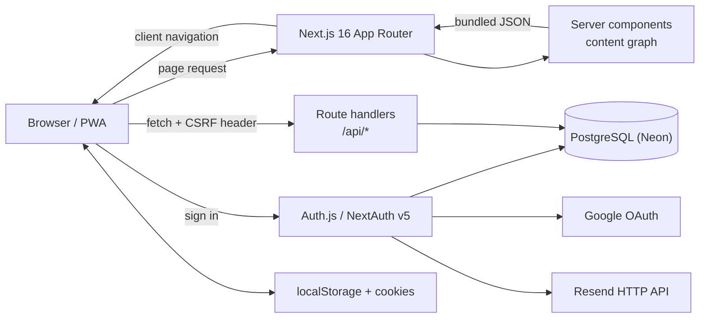
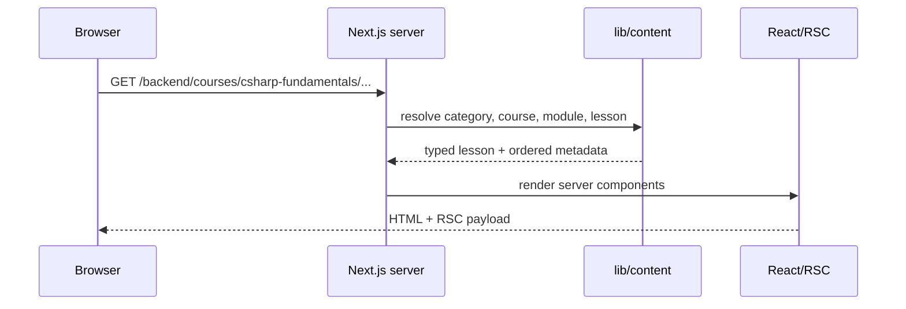
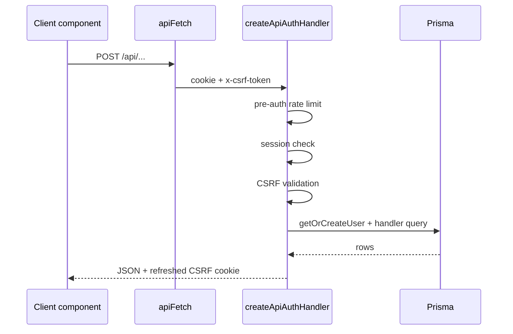

# Architecture

Quotient is a content-heavy Next.js App Router application. Content is compiled
from JSON at build time, accounts and user state live in PostgreSQL, and a small
authenticated API sits between the browser and the database.

---

## 1. System at a glance



Three persistence planes are separate:

| Plane | Holds | Source of truth |
| --- | --- | --- |
| Build-time content | Courses, modules, lessons, problems, cheat sheets, questions, roadmaps, glossary, prompts | JSON under `content/` |
| PostgreSQL | Users, Auth.js adapter rows, progress, bookmarks, notes, offline queue, preferences | `prisma/schema.prisma` |
| Browser | Theme, appearance mirror, last path for signed-out visitors, recent searches, legacy migrations | `lib/storageKeys.ts` and feature hooks |

Content is never stored in PostgreSQL. User state is never written into the
content tree.

---

## 2. Runtime stack

| Layer | Choice |
| --- | --- |
| Framework | Next.js 16 App Router (`next dev --webpack`, `next build --webpack`) |
| UI | React 19 |
| Language | TypeScript 6, strict mode |
| Styling | Tailwind CSS 3 with semantic CSS-variable tokens |
| Auth | NextAuth v5 / Auth.js with Google OAuth, email magic links, Prisma Adapter, JWT sessions |
| Database | PostgreSQL via Prisma Client |
| Code highlighting | `react-shiki` (Shiki) |
| Diagrams | Mermaid, dynamically imported on the client |
| PWA | `@ducanh2912/next-pwa` |
| Search | In-process scoring over the bundled content graph |

Next.js 16 requires Node.js `>=20.9.0`; the project uses Yarn 1.22.

---

## 3. Repository layout

| Path | Responsibility |
| --- | --- |
| `app/` | Routes, layouts, metadata, API route handlers, sitemap, robots |
| `components/` | UI grouped by feature (`layout`, `content`, `course`, `user`, `lesson`, `progress`, `bookmarks`, `ui`, …) |
| `content/` | Category-first content tree plus generated indexes |
| `hooks/` | Client-side state and browser behavior |
| `lib/` | Content graph, href builders, auth, Prisma, validation, caching, SEO, appearance |
| `types/` | Domain and content-block types |
| `prisma/` | Database schema and migrations |
| `scripts/` | Content generation, content tests, deployment build |
| `agents/` | Reference and role documentation |

`app/` may import from `components/`, `lib/`, and `content/`. The reverse is not
allowed: components must not import from `app/`. `lib/content.ts` eagerly loads
the entire content graph, so client components must use `lib/content-hrefs.ts`
or receive data as props.

---

## 4. Rendering model

- Pages are server components by default. They resolve slugs, validate the
  category/URL relationship, and pass only the metadata a client component
  needs.
- Interactive islands are explicit client components under `components/`.
  Lesson bodies render on the server; code blocks and Mermaid load dynamically.
- Dynamic content routes implement `generateStaticParams()`. Course, problem,
  cheat-sheet, question-answer, glossary, prompt, and home pages are
  prerendered.
- `next.config.ts` sets `typescript.ignoreBuildErrors: true`. `yarn typecheck`
  is the type gate, not `next build`.
- `experimental.cacheComponents` is intentionally disabled. With all lessons
  prerendered, enabling it would count each static page as a route and exceed
  Vercel's per-deployment limit.
- `serverMinification` is disabled because the server bundle is dominated by
  lesson JSON; browser bundles stay minified.

### Route map

| Route | Purpose |
| --- | --- |
| `/` | Landing page and section discovery |
| `/[category]/courses` | Courses in one category |
| `/[category]/courses/[courseSlug]` | Course overview |
| `/[category]/courses/[courseSlug]/[moduleSlug]` | Module overview |
| `/[category]/courses/[courseSlug]/[moduleSlug]/[lessonSlug]` | Lesson |
| `/[category]/problems` | Problem sets in one category |
| `/[category]/problems/[courseSlug]` | Problem course overview |
| `/[category]/problems/[courseSlug]/[moduleSlug]` | Problem module |
| `/[category]/problems/[courseSlug]/[moduleSlug]/[lessonSlug]` | Problem lesson |
| `/[category]/cheatsheets` | Cheat-sheet list |
| `/[category]/cheatsheets/[technology]` | One cheat sheet |
| `/[category]/question-answers` | Technology list |
| `/[category]/question-answers/[technology]` | Questions for one technology |
| `/[category]/question-answers/[technology]/[slug]` | One question |
| `/[category]/roadmap` | Curated learning path |
| `/ai/glossary` | Searchable AI glossary |
| `/ai/prompts` | Prompt template library |
| `/search` | Public search page |
| `/login` | Google and magic-link sign-in |
| `/login/verify-request` | “Check your email” confirmation |
| `/login/error` | Friendly sign-in error |
| `/user/*` | Authenticated account area |
| `/sitemap.xml`, `/robots.txt` | Generated metadata routes |

Categories come from the content tree: `ai`, `architecture`, `backend`,
`database`, `devops`, `frontend`, and `fundamentals`. `fundamentals` is
intentionally hidden from the navigation bar.

There are no top-level `/courses`, `/problems`, `/cheatsheet`, or
`/question-answers` pages. Old `/dotnet/*` and `/cloud/*` URLs permanently
redirect to `/backend/*` and `/devops/*`.

---

## 5. Content pipeline

Content is JSON under `content/`, organized category-first with separate trees
for courses, problems, cheat sheets, question answers, roadmaps, glossary terms,
and prompts.

`scripts/generate-content-indices.ts` writes `content/courses.ts`,
`content/modules.ts`, `content/lessons.ts`, `content/categories.ts`, and
`content/roadmaps.ts`. `predev` and `prebuild` run it automatically; it can also
be run with `yarn generate:content`. Generated files are never edited by hand.

At runtime `lib/content.ts` provides slug lookups, course/module/lesson
queries, ordering, TOC extraction, related-lesson resolution, roadmap
resolution, and search. Question answers reuse the course/module/lesson model:
one technology is one module, and the module slug is the URL segment.

Search is computed in-process by `searchAll()`. It scores title, description,
and tags, supports token and fuzzy matching, and returns snippets. There is no
external search index or database full-text query.

---

## 6. Request flows

### Public page request



The page verifies that the URL category matches the course's generated
`urlCategory`; a mismatch returns `notFound()`. Client components receive
`LessonNavItem` metadata without `blocks`, keeping the RSC payload small.

### Authenticated mutation



`createApiAuthHandler` enforces a 60-request/minute pre-auth limit per IP,
requires an Auth.js session, validates the double-submit CSRF token for
non-GET requests, resolves the Prisma user, and ensures the CSRF cookie is
present on every response. Individual handlers add their own per-method limits.

### Sign-in

Google OAuth and email magic links share `/api/auth/[...nextauth]`. The
magic-link POST is wrapped to throttle per IP and per email before Auth.js
creates a verification token. Emails go through the Resend HTTP API in
`lib/magicLink.ts`; in development, when `RESEND_API_KEY` is absent, the link is
logged instead. Sessions are JWTs; the Prisma Adapter still stores accounts,
sessions, verification tokens, and authenticators.

---

## 7. Client state and providers

`app/layout.tsx` wraps the app in this order:

```text
AuthProvider (SessionProvider)
└── ProgressProvider
    └── BookmarkProvider
        └── PreferencesProvider
            └── ThemeProvider
                Navbar, main, Footer, OfflineIndicator
```

| Concern | Signed in | Signed out |
| --- | --- | --- |
| Progress, bookmarks | PostgreSQL through `/api/progress` and `/api/bookmarks`; gated by `SignInPrompt` | Not persisted; legacy `localStorage` data is migrated on sign-in |
| Last path | `/api/last-path` | `localStorage` |
| Theme | `/api/user/theme` + `localStorage` | `localStorage` via `next-themes` |
| Appearance | `/api/user/preferences` + `localStorage` + cookie mirror | `localStorage` + cookie mirror |
| Notes, offline queue | PostgreSQL APIs | Sign-in required |
| Recent searches | `localStorage` | `localStorage` |

The appearance cookie is read by a blocking script in the root layout so font
size and density apply before first paint.

---

## 8. Security boundaries

- `/user/*` is gated by `app/user/layout.tsx`; API routes are gated by
  `createApiAuthHandler`. Handlers never accept a user ID from the client.
- Mutating API requests require the `quotient_csrf` cookie echoed in
  `x-csrf-token`. `apiFetch` handles this for client code.
- Request bodies are constrained with Zod in `lib/validators.ts`.
- Rate limits are in-memory sliding windows keyed by client IP and route. They
  are per instance, not global across serverless instances.
- Auth and database secrets stay in server environment variables. Only
  `NEXT_PUBLIC_*` values reach the browser.
- Lesson content is rendered through dedicated components; raw HTML is not
  injected. External links use `rel="noopener noreferrer"`.

---

## 9. Caching and deployment

- Static generation produces HTML for all content routes.
- Progress and bookmark GET responses use a 30-second in-memory cache per user,
  invalidated on writes.
- Search is capped at 200 characters and 20 requests/minute per IP.
- Sidebars receive lesson metadata without `blocks`.
- Shiki, Mermaid, and modals are dynamically imported.
- `app/sitemap.ts` lists static routes and walks all content, de-duplicating
  URLs. `app/robots.ts` blocks `/api/`, `/login`, and `/user/`.
- `scripts/vercel-build.js` runs `prisma generate`, `prisma migrate deploy`, and
  the Next.js build. It handles an already-populated database without migration
  history before retrying.

The app can serve public content without a database, but sign-in and every
account feature need `DATABASE_URL` plus Auth.js credentials.

---

## 10. Where to extend

| Change | Primary files |
| --- | --- |
| Add a content block type | `types/index.ts`, `components/content/ContentBlockRenderer.tsx` |
| Add a content category | `content/<category>/…`, `lib/content.ts` (`CATEGORY_META`, `CATEGORY_ORDER`) |
| Add a route | `app/<route>/page.tsx`, navigation in `lib/content.ts`, `app/sitemap.ts`, `app/robots.ts` |
| Add an API endpoint | `app/api/<name>/route.ts`, `lib/validators.ts`, perhaps `lib/cache.ts` |
| Add an account page | `app/user/<page>/`, `components/user/UserNav.tsx`, Navbar user menu |
| Change user persistence | `prisma/schema.prisma`, a migration, the relevant route handler, and the matching provider/hook |
| Change appearance behavior | `lib/appearance.ts`, `hooks/useUserPreferences.ts`, `components/user/PreferencesProvider.tsx`, `app/globals.css` |
