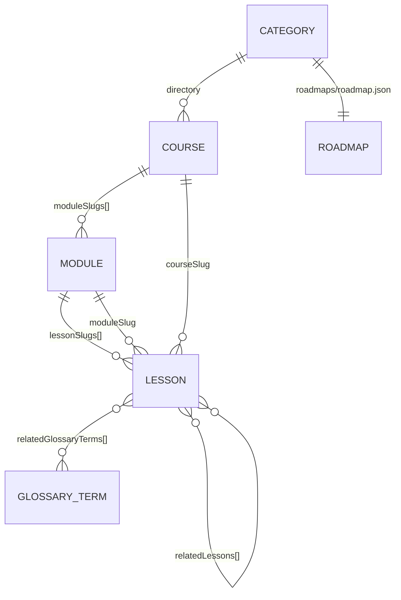
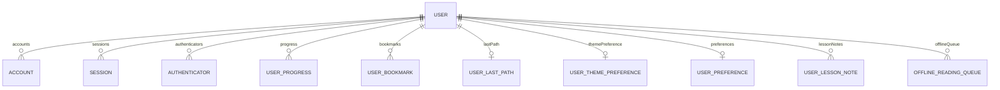

# Data Model

Quotient has three data planes:

1. **Content JSON** — the source of truth for everything a learner reads.
2. **PostgreSQL** — accounts, Auth.js adapter rows, and per-user state.
3. **Browser storage and cookies** — device-local preferences, a signed-out
   last path, recent searches, and legacy migration input.

The canonical type definitions live in `types/index.ts`; the database schema
lives in `prisma/schema.prisma`. This document describes the data shapes and
storage layers only.

---

## 1. Content tree

Content is category-first. A category is a directory under `content/`:

```text
content/
  ai/
  architecture/
  backend/
  database/
  devops/
  frontend/
  fundamentals/
```

Each category can contain:

| Section          | Directory                        | Route                                              |
| ---------------- | -------------------------------- | -------------------------------------------------- |
| Courses          | `courses/<courseSlug>/`          | `/[category]/courses/...`                          |
| Problems         | `problems/<courseSlug>/`         | `/[category]/problems/...`                         |
| Cheat sheets     | `cheatsheet/<technology>/`       | `/[category]/cheatsheets/[technology]`             |
| Question answers | `question-answers/<technology>/` | `/[category]/question-answers/[technology]/[slug]` |
| Roadmap          | `roadmaps/roadmap.json`          | `/[category]/roadmap`                              |

The AI category additionally has `glossary/<topic>/<term>.json` and
`prompts/<topic>/<prompt>.json`, served by the dedicated `/ai/glossary` and
`/ai/prompts` pages.

`content/cheatsheet.json` and `content/question-answers.json` are section-level
course records. They register the special “courses” whose modules are
technologies rather than subjects.

### Identity and relationships



- A lesson stores both `courseSlug` and `moduleSlug`. Lookups filter by both, so
  repeated lesson slugs in different modules cannot leak across a course.
- `Course.moduleSlugs` and `Module.lessonSlugs` define membership and order.
  The `order` fields define sort order.
- Question-answer lessons also carry a display `technology`. The module slug is
  the technology slug, which is also the URL segment.
- Roadmap steps reference content by `kind` + `ref`; titles and hrefs are
  resolved from the content graph at render time.

### Course fields

| Field              | Type       | Required  | Meaning                                  |
| ------------------ | ---------- | --------- | ---------------------------------------- |
| `id`               | `string`   | yes       | Stable content ID                        |
| `slug`             | `string`   | yes       | URL segment and lookup key               |
| `title`            | `string`   | yes       | Display title                            |
| `subtitle`         | `string`   | yes       | Short supporting line                    |
| `description`      | `string`   | yes       | Listing description                      |
| `icon`             | `string`   | yes       | Emoji or icon token                      |
| `color`            | `string`   | yes       | Accent token used by cards               |
| `order`            | `number`   | yes       | Sort order                               |
| `category`         | `string`   | no        | Legacy display category                  |
| `urlCategory`      | `string`   | generated | Set by the content generator             |
| `isQuestionAnswer` | `boolean`  | no        | Marks the question-answer section record |
| `moduleSlugs`      | `string[]` | yes       | Ordered module membership                |

### Module fields

| Field             | Type         | Required  | Meaning                                   |
| ----------------- | ------------ | --------- | ----------------------------------------- |
| `id`              | `string`     | yes       | Stable content ID                         |
| `slug`            | `string`     | yes       | URL segment and lookup key                |
| `courseSlug`      | `string`     | yes       | Parent course                             |
| `title`           | `string`     | yes       | Display title                             |
| `description`     | `string`     | yes       | Listing description                       |
| `longDescription` | `string`     | no        | Expanded overview                         |
| `order`           | `number`     | yes       | Sort order within the course              |
| `difficulty`      | `Difficulty` | yes       | `beginner`, `intermediate`, or `advanced` |
| `estimatedHours`  | `number`     | yes       | Rough time estimate                       |
| `icon`            | `string`     | yes       | Emoji or icon token                       |
| `urlCategory`     | `string`     | generated | Set by the content generator              |
| `tags`            | `string[]`   | no        | Search and filtering                      |
| `lessonSlugs`     | `string[]`   | no        | Ordered lesson membership                 |
| `isOptional`      | `boolean`    | no        | Marks optional material                   |
| `skipLabel`       | `string`     | no        | Label for optional material               |
| `prerequisites`   | `string[]`   | no        | Module slugs                              |
| `whatYouLearn`    | `string[]`   | no        | Learning outcomes                         |

### Lesson fields

| Field                  | Type                   | Required         | Meaning                         |
| ---------------------- | ---------------------- | ---------------- | ------------------------------- |
| `id`                   | `string`               | yes              | Stable content ID               |
| `slug`                 | `string`               | yes              | URL segment and lookup key      |
| `moduleSlug`           | `string`               | yes              | Parent module                   |
| `courseSlug`           | `string`               | yes              | Parent course                   |
| `title`                | `string`               | yes              | Display title                   |
| `description`          | `string`               | yes              | Summary and search text         |
| `order`                | `number`               | yes              | Sort order within the module    |
| `difficulty`           | `Difficulty`           | yes              | Difficulty label                |
| `estimatedMinutes`     | `number`               | yes              | Reading/working time            |
| `tags`                 | `string[]`             | no               | Search and filtering            |
| `technology`           | `string`               | question answers | Display technology, e.g. `"C#"` |
| `prerequisites`        | `string[]`             | no               | Lesson slugs                    |
| `isOptional`           | `boolean`              | no               | Marks optional material         |
| `skipLabel`            | `string`               | no               | Label for optional material     |
| `blocks`               | `ContentBlock[]`       | yes              | Lesson body                     |
| `relatedLessons`       | `string[]`             | no               | Same-course lesson slugs        |
| `relatedGlossaryTerms` | `string[]`             | no               | Glossary slugs                  |
| `furtherReading`       | `FurtherReadingItem[]` | no               | External reading                |

`FurtherReadingItem` has `title`, `url`, `type` (`article`, `video`, `course`,
or `tool`), and optional `author` and `description`.

---

## 2. Content blocks

Lesson JSON uses the discriminated union declared in `types/index.ts`. The
canonical shape is **nested** under `data`:

```json
{
  "type": "callout",
  "id": "optional-block-id",
  "data": {
    "variant": "tip",
    "title": "Try it",
    "text": "Run the example before changing it."
  }
}
```

`ContentBlockRenderer` also normalizes legacy flat blocks (`{ "type": "paragraph", "text": "…" }`)
and a few older field names. New content must use the nested `data` shape and
match the neighboring lessons.

| Type               | `data` fields                                                            |
| ------------------ | ------------------------------------------------------------------------ |
| `paragraph`        | `text`                                                                   |
| `heading`          | `level` (`2 \| 3 \| 4`), `text`, optional `anchor`                       |
| `bullet-list`      | `items: string[]`, optional `title`                                      |
| `numbered-list`    | `items: string[]`, optional `title`                                      |
| `callout`          | `variant`, optional `title`, `text`                                      |
| `quote`            | `text`, optional `attribution`                                           |
| `key-terms`        | `terms: { term, definition, learnMoreSlug? }[]`                          |
| `table`            | `headers: string[]`, `rows: string[][]`                                  |
| `example`          | optional `title`, `content`, optional `code`, optional `language`        |
| `code`             | `language`, `code`, optional `caption`                                   |
| `solution`         | optional `title`, `content`, `code`, optional `language`                 |
| `exercise`         | `title`, `description`, optional `steps`, optional `expectedOutcome`     |
| `checklist`        | `items: { text, hint? }[]`, optional `title`                             |
| `mermaid`          | `id`, `definition`, optional `caption`                                   |
| `comparison-cards` | optional `title`, `cards: { title, description, pros?, cons?, tags? }[]` |
| `summary-box`      | optional `title`, `points: string[]`, optional `takeaway`                |
| `faq-block`        | optional `title`, `items: { question, answer }[]`                        |
| `divider`          | none (`{}`)                                                              |
| `image`            | `src`, `alt`, optional `caption`                                         |

`CalloutVariant` is `info`, `tip`, `warning`, `note`, `important`, `danger`, or
`error`. `ComparisonCardItem`, `KeyTermItem`, `ChecklistItem`, `ExerciseData`,
and `FAQItem` are exported from `types/index.ts`.

Compatibility normalizations in `ContentBlockRenderer.tsx`:

- `comparison-cards` with `data.items` instead of `data.cards`
- `summary-box` with `data.items` or `data.text` instead of `data.points`
- `faq-block` with `data.faqs` instead of `data.items`
- fully flat blocks with fields directly on the block object

---

## 3. Roadmaps, glossary, and prompts

### Roadmap

One roadmap per category, stored at `content/<category>/roadmaps/roadmap.json`.

| Field            | Type             | Required | Meaning               |
| ---------------- | ---------------- | -------- | --------------------- |
| `id`             | `string`         | yes      | Stable ID             |
| `slug`           | `string`         | yes      | Always `"roadmap"`    |
| `category`       | `string`         | yes      | Owning category       |
| `title`          | `string`         | yes      | Display title         |
| `description`    | `string`         | yes      | Listing description   |
| `icon`           | `string`         | yes      | Emoji or icon token   |
| `audience`       | `string`         | no       | Who the path is for   |
| `estimatedTotal` | `string`         | no       | Overall time estimate |
| `intro`          | `string`         | no       | Intro paragraph       |
| `stages`         | `RoadmapStage[]` | yes      | Ordered stages        |

A stage has `id`, `title`, `description`, `level` (difficulty), optional
`duration`, optional `milestone`, and `steps`. A step has:

| Field   | Meaning                                                         |
| ------- | --------------------------------------------------------------- |
| `kind`  | `course`, `problems`, `cheatsheet`, `questionAnswer`, or `link` |
| `ref`   | Content slug or explicit href for `link`                        |
| `title` | Required for `link`; resolved automatically otherwise           |
| `note`  | Optional guidance                                               |

`resolveRoadmapStep()` turns each step into a `ResolvedRoadmapStep` containing
`title`, `description`, `href`, `icon`, optional `meta`, and optional `note`.
Invalid references are omitted rather than rendered as broken links.

### Glossary term

Stored at `content/ai/glossary/<topic>/<slug>.json`.

| Field             | Type               | Required | Meaning             |
| ----------------- | ------------------ | -------- | ------------------- |
| `id`              | `string`           | yes      | Stable ID           |
| `slug`            | `string`           | yes      | Lookup key          |
| `term`            | `string`           | yes      | Display term        |
| `phonetic`        | `string`           | no       | Pronunciation hint  |
| `shortDefinition` | `string`           | yes      | One-line definition |
| `fullDefinition`  | `string`           | yes      | Full explanation    |
| `category`        | `GlossaryCategory` | yes      | Topic group         |
| `difficulty`      | `Difficulty`       | yes      | Difficulty label    |
| `relatedTerms`    | `string[]`         | no       | Glossary slugs      |
| `learnMoreSlug`   | `string`           | no       | Lesson slug         |
| `examples`        | `string[]`         | no       | Examples            |
| `alsoKnownAs`     | `string[]`         | no       | Alternate names     |

`GlossaryCategory` values: `core-concepts`, `models-and-training`, `prompting`,
`tools-and-apis`, `agents-and-automation`, `safety-and-ethics`, `architecture`,
`multimodal`, `evaluation`.

### Prompt template

Stored at `content/ai/prompts/<topic>/<slug>.json`.

| Field         | Type             | Required | Meaning                                   |
| ------------- | ---------------- | -------- | ----------------------------------------- |
| `id`          | `string`         | yes      | Stable ID                                 |
| `slug`        | `string`         | yes      | Lookup key                                |
| `title`       | `string`         | yes      | Display title                             |
| `description` | `string`         | yes      | What the prompt does                      |
| `category`    | `PromptCategory` | yes      | Topic group                               |
| `difficulty`  | `Difficulty`     | yes      | Difficulty label                          |
| `template`    | `string`         | yes      | Prompt text with `[PLACEHOLDER]` brackets |
| `example`     | `string`         | no       | Filled-in example                         |
| `tags`        | `string[]`       | yes      | Search and filtering                      |
| `tips`        | `string[]`       | no       | Usage advice                              |
| `isStarter`   | `boolean`        | no       | Marks beginner-friendly prompts           |

`PromptCategory` values: `writing`, `thinking`, `research`, `coding`,
`creativity`, `productivity`, `learning`, `analysis`, `summarization`.

---

## 4. PostgreSQL schema

The Prisma schema is the source of truth. All user rows cascade on user delete.



### Enums

| Enum               | Values                                              |
| ------------------ | --------------------------------------------------- |
| `ProgressCategory` | `lessons`, `problems`, `questionAnswers`            |
| `BookmarkType`     | `lesson`, `problem`, `questionAnswer`, `cheatsheet` |
| `UserTheme`        | `light`, `dark`, `system`                           |

### `users`

| Column           | Type           | Notes                     |
| ---------------- | -------------- | ------------------------- |
| `id`             | `text`         | Primary key, default UUID |
| `email`          | `text?`        | Unique                    |
| `email_verified` | `timestamptz?` |                           |
| `name`           | `text?`        |                           |
| `image`          | `text?`        |                           |
| `created_at`     | `timestamptz?` | Defaults to now           |

`getOrCreateUser()` upserts on `email` and uses the Auth.js user ID when
available. The API wrapper resolves this row before calling a handler.

### Auth.js adapter tables

| Table                 | Key constraints                                                           |
| --------------------- | ------------------------------------------------------------------------- |
| `accounts`            | Composite primary key `(provider, providerAccountId)`; index on `user_id` |
| `sessions`            | Unique `session_token`; index on `user_id`                                |
| `verification_tokens` | Composite primary key `(identifier, token)`                               |
| `authenticators`      | Composite primary key `(user_id, credentialID)`; unique `credential_id`   |

Sessions are configured as JWTs, so the `sessions` table is adapter
infrastructure rather than the active session store.

### `user_progress`

| Column         | Type               | Notes                                     |
| -------------- | ------------------ | ----------------------------------------- |
| `id`           | `uuid`             | Primary key                               |
| `user_id`      | `text`             | FK → `users.id`, cascade                  |
| `category`     | `ProgressCategory` | Lesson / problem / question-answer bucket |
| `lesson_slug`  | `text`             | Content slug                              |
| `module_slug`  | `text`             | Content slug                              |
| `completed_at` | `timestamptz`      | Defaults to now                           |

Unique on `(user_id, category, lesson_slug)`. Completing the same lesson twice
is a no-op. Deleting progress removes all of a user's rows; there is no
single-lesson delete endpoint.

### `user_bookmarks`

| Column        | Type           | Notes                     |
| ------------- | -------------- | ------------------------- |
| `id`          | `uuid`         | Primary key               |
| `user_id`     | `text`         | FK → `users.id`, cascade  |
| `type`        | `BookmarkType` | Content kind              |
| `slug`        | `text`         | Content slug              |
| `title`       | `text`         | Snapshot used for listing |
| `course_slug` | `text`         | Parent course             |
| `module_slug` | `text`         | Parent module             |
| `added_at`    | `timestamptz`  | Defaults to now           |

Unique on `(user_id, type, slug)`. The title is stored so the bookmarks page can
render even if content is renamed later.

### `user_last_path`

One row per user. Primary key `user_id`. Stores `path` and `updated_at`.

### `user_theme_preferences`

One row per user. Primary key `user_id`. Stores `theme` (`UserTheme`) and
`updated_at`.

### `user_preferences`

One row per user. Primary key `user_id`.

| Column             | Type          | Default |
| ------------------ | ------------- | ------- |
| `font_size`        | `text?`       | `null`  |
| `density`          | `text?`       | `null`  |
| `code_font_size`   | `text?`       | `null`  |
| `reduced_motion`   | `boolean`     | `false` |
| `auto_expand_code` | `boolean`     | `true`  |
| `show_completed`   | `boolean`     | `true`  |
| `default_landing`  | `text?`       | `null`  |
| `updated_at`       | `timestamptz` | `now()` |

The API validates field types, not enum membership. The UI is responsible for
sending supported values.

### `user_lesson_notes`

| Column        | Type          | Notes                                              |
| ------------- | ------------- | -------------------------------------------------- |
| `id`          | `uuid`        | Primary key                                        |
| `user_id`     | `text`        | FK → `users.id`, cascade                           |
| `course_slug` | `text`        | Parent course                                      |
| `module_slug` | `text`        | Parent module                                      |
| `lesson_slug` | `text`        | Lesson                                             |
| `content`     | `text`        | Defaults to `""`; API requires 1–50,000 characters |
| `updated_at`  | `timestamptz` | Updated on write                                   |

Unique on `(user_id, course_slug, module_slug, lesson_slug)`. One note per
lesson per user.

### `offline_reading_queue`

| Column        | Type          | Notes                        |
| ------------- | ------------- | ---------------------------- |
| `id`          | `uuid`        | Primary key                  |
| `user_id`     | `text`        | FK → `users.id`, cascade     |
| `course_slug` | `text`        | Parent course                |
| `module_slug` | `text`        | Parent module                |
| `lesson_slug` | `text`        | Lesson                       |
| `title`       | `text`        | Snapshot for offline listing |
| `queued_at`   | `timestamptz` | Defaults to now              |

Unique on `(user_id, course_slug, module_slug, lesson_slug)`. One queue entry per
lesson per user.

---

## 5. Browser storage and cookies

Canonical keys are exported from `lib/storageKeys.ts` unless noted.

| Key                        | Store          | Written by                     | Purpose                                            |
| -------------------------- | -------------- | ------------------------------ | -------------------------------------------------- |
| `quotient_theme`           | `localStorage` | `next-themes` / `useUserTheme` | Theme before the server preference loads           |
| `quotient_preferences`     | `localStorage` | `useUserPreferences`           | Signed-out personalization                         |
| `quotient_appearance`      | cookie         | `lib/appearance.ts`            | Pre-paint font size, density, and motion mirror    |
| `quotient_last_path`       | `localStorage` | `ContinuePrompt`               | Signed-out resume path                             |
| `quotient_prompt_shown`    | `localStorage` | `ContinuePrompt`               | Prevents repeated resume prompts                   |
| `quotient_progress`        | `localStorage` | Legacy data only               | Read by `lib/userSync.ts` during sign-in migration |
| `quotient_bookmarks`       | `localStorage` | Legacy data only               | Read by `lib/userSync.ts` during sign-in migration |
| `quotient_csrf`            | cookie         | `lib/csrf.ts`                  | Double-submit CSRF token                           |
| `quotient:recent-searches` | `localStorage` | `hooks/useRecentSearches.ts`   | Recent search suggestions                          |

Progress and bookmarks are **not** written to `localStorage` by the current
providers. Signed-out visitors see `SignInPrompt` instead. The `quotient_progress`
and `quotient_bookmarks` keys exist only as migration input for accounts that
used an older version of the app.

---

## 6. Data lifecycle

| Event                       | Effect                                                                                                                                                                                        |
| --------------------------- | --------------------------------------------------------------------------------------------------------------------------------------------------------------------------------------------- |
| First sign-in               | Auth.js creates/updates the user and adapter rows; API calls upsert the Prisma user; legacy local progress, bookmarks, theme, preferences, and last path may be migrated by `lib/userSync.ts` |
| Complete a lesson           | Insert a progress row, ignoring duplicates                                                                                                                                                    |
| Remove a bookmark           | Delete the matching `(user, type, slug)` row                                                                                                                                                  |
| Clear all bookmarks         | Delete every bookmark row for the user                                                                                                                                                        |
| Save a note                 | Upsert on `(user, course, module, lesson)`; empty content is rejected by the API                                                                                                              |
| Queue offline reading       | Insert a queue row, ignoring duplicates                                                                                                                                                       |
| Change theme or preferences | Upsert the single preference row for the user                                                                                                                                                 |
| Account reset               | Delete one group (`progress`, `bookmarks`, `notes`, `offline`); preferences, theme, and account identity are preserved                                                                        |
| Sign out                    | Client state clears; server rows remain                                                                                                                                                       |

Account deletion is not exposed by the app. The danger zone resets data groups,
not the account itself.
